# Coverage & Skills Taxonomy Report

> **Data Directory Scanned**: `drills/data`  
> **Skills Taxonomy Registered**: 43 skills across 6 domains

---

## 1. Skill (Domain, Tier) × Level × Form Matrix

ตารางเปรียบเทียบ Skill ใน `skills_taxonomy.json` กับ Template ที่รองรับ และจำนวนโจทย์จริงใน `drills/data/` (ตัดจำนวนโจทย์ซ้ำจากไฟล์ `-studio` ออกแล้ว):

| Domain | Skill ID | Skill Name | Tier | Level | Template Key | Forms Produced | Drill Problems in `drills/data` |
| :--- | :--- | :--- | :--- | :---: | :--- | :--- | :---: |
| `geometry` | `GEO-CIRCLE-AREA-DIAMETER` | Calculate Circular Area in Terms of Pi Given Diameter | `intermediate` | L2 | `circle-area-pi` | `from-diameter` | 0 |
| `geometry` | `GEO-CIRCLE-AREA-RADIUS` | Calculate Circular Area in Terms of Pi Given Radius | `intermediate` | L2 | `circle-area-pi` | `direct` | **6** |
| `geometry` | `GEO-CYLINDER-VOLUME-DIAMETER` | Calculate Exact Cylinder Volume Given Diameter and Height | `intermediate` | L2 | `cylinder-volume` | `from-diameter` | 0 |
| `geometry` | `GEO-CYLINDER-VOLUME-RADIUS` | Calculate Exact Cylinder Volume Given Radius and Height | `intermediate` | L2 | `cylinder-volume` | `direct` | **9** |
| `geometry` | `GEO-RIGHT-TRIANGLE-APPLIED` | Apply Pythagorean Theorem to Contextual Distance Models | `intermediate` | L2 | `pythagoras-hypotenuse` | `contextual` | 0 |
| `geometry` | `GEO-RIGHT-TRIANGLE-HYP` | Calculate Hypotenuse via Pythagorean Theorem | `foundational` | L1 | `pythagoras-hypotenuse` | `direct` | **8** |
| `geometry` | `GEO-RIGHT-TRIANGLE-LEG` | Solve for Missing Leg via Pythagorean Theorem | `intermediate` | L2 | `pythagoras-hypotenuse` | `reverse` | **3** |
| `geometry` | `GEO-TRAPEZOID-AREA` | Calculate Trapezoid Area from Bases and Height | `intermediate` | L2 | `trapezoid-area` | `direct` | **7** |
| `geometry` | `GEO-TRAPEZOID-HEIGHT` | Solve for Missing Trapezoid Height Given Area and Bases | `intermediate` | L2 | `trapezoid-area` | `reverse` | 0 |
| `complex_numbers` | `MTH-COMPLEX-AC-OHMS-LAW` | Calculate AC Voltage and Current via Complex Impedance | `expert` | L4 | `ac-current` | `direct` | **30** |
| `complex_numbers` | `MTH-COMPLEX-ADDITION` | Add Complex Numbers in Standard Form | `foundational` | L1 | `add-subtract` | `addition` | **2** |
| `complex_numbers` | `MTH-COMPLEX-DIAGNOSTIC-FLAW` | Diagnose Step Errors in Complex Algebraic Derivations | `advanced` | L3 | `find-the-flaw` | `flaw-line-1`, `flaw-line-2`, `flaw-line-3` | **3** |
| `complex_numbers` | `MTH-COMPLEX-DIVISION-CONJUGATE` | Divide Complex Numbers via Conjugate Rationalization | `intermediate` | L2 | `divide-conjugate` | `direct`, `pure-imaginary-denom`, `reciprocal` | **2** |
| `complex_numbers` | `MTH-COMPLEX-EVALUATE-POLYNOMIAL` | Evaluate Polynomial Expressions at Complex Roots | `intermediate` | L2 | `evaluate-polynomial` | `direct` | **4** |
| `complex_numbers` | `MTH-COMPLEX-GEOMETRIC-ROTATION` | Transform 2D Vectors via Complex Multiplication in Argand Plane | `expert` | L4 | `rotation-2d` | `rot--1`, `rot--i`, `rot-i` | **31** |
| `complex_numbers` | `MTH-COMPLEX-MULTIPLICATION` | Multiply Complex Binomials via Distributive FOIL | `intermediate` | L2 | `multiply` | `direct`, `missing-coefficient`, `pure-imaginary` | **3** |
| `complex_numbers` | `MTH-COMPLEX-PARALLEL-IMPEDANCE` | Synthesize Equivalent Impedance for Parallel AC Circuits | `expert` | L4 | `parallel-impedance` | `direct` | **30** |
| `complex_numbers` | `MTH-COMPLEX-POWER-I-MOD4` | Evaluate Integer Powers of Imaginary Unit Modulo 4 | `foundational` | L1 | `power-of-i` | `rem-0`, `rem-1`, `rem-2`, `rem-3` | **2** |
| `complex_numbers` | `MTH-COMPLEX-POWER-SUM` | Compute Geometric Sum of Consecutive Powers of i | `intermediate` | L2 | `power-sum` | `direct` | **2** |
| `complex_numbers` | `MTH-COMPLEX-PRINCIPAL-ROOT-TRAP` | Resolve Radical Fallacy for Negative Radicands | `advanced` | L3 | `principal-root-trap` | `direct` | **1** |
| `complex_numbers` | `MTH-COMPLEX-RADICAL-SIMPLIFY` | Simplify Principal Square Root of Negative Real Numbers | `foundational` | L1 | `radical-standard-form` | `direct` | **2** |
| `complex_numbers` | `MTH-COMPLEX-SQUARE-BINOMIAL` | Square Complex Binomials | `intermediate` | L2 | `square-binomial` | `direct` | **3** |
| `complex_numbers` | `MTH-COMPLEX-SUBTRACTION` | Subtract Complex Numbers in Standard Form | `foundational` | L1 | `add-subtract` | `subtraction` | 0 |
| `javascript_core` | `PRG-JS-EVENT-LOOP-MICROTASK` | Predict Microtask vs Macrotask Execution Order | `intermediate` | L2 | `event_loop_concurrency` | `direct` | **7** |
| `javascript_core` | `PRG-JS-PROMISE-ASYNC-FLOW` | Trace Asynchronous Promise Rejection and Resolution Flow | `intermediate` | L2 | `promise_async_flow` | `reject-catch`, `resolve-then` | **1** |
| `javascript_core` | `PRG-JS-PROTOTYPE-CHAIN-MUTATION` | Analyze Prototype Chain Mutations and Inheritance | `expert` | L4 | `prototype_chain_mutation` | `direct` | **1** |
| `javascript_core` | `PRG-JS-SCOPE-HOISTING-LET` | Trace let Block Scope Binding per Loop Iteration | `foundational` | L1 | `scope_hoisting_loop` | `let-loop` | 0 |
| `javascript_core` | `PRG-JS-SCOPE-HOISTING-VAR` | Trace var Loop Closure Capture and Function Scope | `foundational` | L1 | `scope_hoisting_loop` | `var-loop` | **2** |
| `javascript_core` | `PRG-JS-THIS-BINDING-DEBUG` | Debug Lost this Context in Detached Callbacks | `advanced` | L3 | `find_bug_this_binding` | `direct` | **2** |
| `software_architecture` | `PRG-ARCH-ASYNC-CACHE-RACE` | Debug Race Conditions and Stampedes in Async Caches | `advanced` | L3 | `debugging_async_cache` | `direct` | **1** |
| `software_architecture` | `PRG-ARCH-PIPELINE-PRICING` | Model Business Pipeline Pricing with Precedence Order | `intermediate` | L2 | `order_pricing_pipeline` | `direct` | **3** |
| `software_architecture` | `PRG-ARCH-PROJECT-RATE-LIMITER` | Implement Stateful Sliding-Window Rate Limiter Architecture | `expert` | L4 | `project_rate_limiter` | `direct` | **4** |
| `software_architecture` | `PRG-ARCH-REFACTOR-SUBSCRIPTION` | Refactor Monolithic Legacy Subscriptions to Clean Modules | `advanced` | L3 | `refactor_legacy_subscription` | `direct` | **3** |
| `software_architecture` | `PRG-KATA-DEBOUNCE` | Implement Function Debounce with Trailing Edge Execution | `intermediate` | L2 | `kata_debounce` | `direct` | **3** |
| `software_architecture` | `PRG-KATA-GROUPBY` | Implement Generic Collection Grouping by Key Selector | `foundational` | L1 | `kata_groupby` | `direct` | **5** |
| `software_architecture` | `PRG-KATA-MEMOIZE` | Implement Unary Function Memoization with Falsy Support | `intermediate` | L2 | `kata_memoize` | `direct` | **4** |
| `calculus` | `CAL-DIFF-CHAIN` | Compute Derivatives of Composite Functions via Chain Rule | `intermediate` | L2, L3 | `diff-chain-rule` | `composite-transcendental`, `direct-power`, `flaw-line-1`, `flaw-line-2`, `flaw-line-3` | 0 |
| `calculus` | `CAL-DIFF-POWER` | Compute Derivatives of Monomials and Polynomials via Power Rule | `foundational` | L1 | `diff-power-rule` | `direct-polynomial`, `rewrite-negative-or-radical` | 0 |
| `vectors` | `VEC-ADD-SCALE` | Vector Addition and Scalar Multiplication | `foundational` | L1, L2 | `vector-add-scale` | `add-sub`, `missing-scalar`, `scalar-mult` | 0 |
| `vectors` | `VEC-DOT-PRODUCT` | Vector Dot Product and Algebraic Properties | `intermediate` | L2 | `vector-dot-product` | `direct` | 0 |
| `vectors` | `VEC-LINEAR-COMBINATION` | Linear Combinations and Basis Representation | `intermediate` | L2 | `vector-add-scale` | `linear-combination` | 0 |
| `vectors` | `VEC-MAGNITUDE` | Calculate Vector Magnitude and Normalized Unit Vectors | `foundational` | L1, L2, L3 | `vector-magnitude` | `flaw-distribute-sqrt`, `magnitude`, `unit-vector` | 0 |
| `vectors` | `VEC-ORTHOGONAL` | Determine Vector Orthogonality and Parameter Solutions | `intermediate` | L2 | `vector-dot-product` | `orthogonal-param` | 0 |

### 1.1 การตรวจสอบความซ้ำซ้อนในไฟล์ `-studio` (Studio File Deduplication Audit)

จากการตรวจสอบโจทย์ในไฟล์ที่ลงท้ายด้วย `-studio` โดยเทียบ Skeleton ของโจทย์แบบ normalized ตัวเลขกับชุดโจทย์หลัก:

| ไฟล์ที่ตรวจสอบ | จำนวนโจทย์ทั้งหมด | โจทย์ที่ซ้ำโครงชุดหลัก | โจทย์ใหม่ที่ไม่ซ้ำ | สถานะการนับใน Coverage Matrix |
| :--- | :---: | :---: | :---: | :--- |
| `DRL-MTH-T01-C12-01-studio-attempt.json` | 5 | **5** | 0 | ตัดออกจากยอดรวม (ไม่นับซ้ำ) |
| `DRL-MTH-T01-C12-02-studio.json` | 5 | **5** | 0 | ตัดออกจากยอดรวม (ไม่นับซ้ำ) |
| `DRL-PRG-T01-C03-01-studio.json` | 10 | **10** | 0 | ตัดออกจากยอดรวม (ไม่นับซ้ำ) |
| `DRL-PRG-T01-C03-02-studio.json` | 5 | **5** | 0 | ตัดออกจากยอดรวม (ไม่นับซ้ำ) |

> [!NOTE]
> ทุกโจทย์ในไฟล์ `-studio` ได้รับการคงไว้ในดิสก์โดยไม่มีการลบหรือย้าย และถูกกรองไม่ให้นับซ้ำในตาราง Coverage Matrix ตามข้อกำหนดอย่างเคร่งครัด

---

## 2. ช่องว่างของระบบ (Coverage Gaps)

### 2.1 Skill ที่มี Template แล้ว แต่ยังไม่มีโจทย์จริงใน `drills/data`

มีทั้งหมด **13** Skills ที่มี Template ใน code engine / math engine พร้อมสร้างโจทย์ แต่ยังไม่เคยรัน generate บันทึกไฟล์ลงใน `drills/data/`:

| Skill ID | Domain | Registered Template | สาเหตุ / สถานะ |
| :--- | :--- | :--- | :--- |
| `GEO-CIRCLE-AREA-DIAMETER` | `geometry` | `circle-area-pi` | Form ทางเลือกหรือโจทย์ประยุกต์ของ template ยังไม่ถูกสุ่มลงในชุดฝึก 2 ชุดแรก |
| `GEO-CYLINDER-VOLUME-DIAMETER` | `geometry` | `cylinder-volume` | Form ทางเลือกหรือโจทย์ประยุกต์ของ template ยังไม่ถูกสุ่มลงในชุดฝึก 2 ชุดแรก |
| `GEO-RIGHT-TRIANGLE-APPLIED` | `geometry` | `pythagoras-hypotenuse` | Form ทางเลือกหรือโจทย์ประยุกต์ของ template ยังไม่ถูกสุ่มลงในชุดฝึก 2 ชุดแรก |
| `GEO-TRAPEZOID-HEIGHT` | `geometry` | `trapezoid-area` | Form ทางเลือกหรือโจทย์ประยุกต์ของ template ยังไม่ถูกสุ่มลงในชุดฝึก 2 ชุดแรก |
| `MTH-COMPLEX-SUBTRACTION` | `complex_numbers` | `add-subtract` | Unit `MTH-T02-C01-U01` อยู่ในสตูดิโอ ยังไม่ได้ generate ลงใน `drills/data/` ส่วนกลาง |
| `PRG-JS-SCOPE-HOISTING-LET` | `javascript_core` | `scope_hoisting_loop` | Unit `PRG-T01-C01` มี template แล้ว แต่ยังไม่ได้รัน generate ชุดฝึกในโฟลเดอร์นี้ |
| `CAL-DIFF-CHAIN` | `calculus` | `diff-chain-rule` | ยังไม่มีการสร้างชุดฝึกที่ครอบคลุม skill นี้ |
| `CAL-DIFF-POWER` | `calculus` | `diff-power-rule` | ยังไม่มีการสร้างชุดฝึกที่ครอบคลุม skill นี้ |
| `VEC-ADD-SCALE` | `vectors` | `vector-add-scale` | ยังไม่มีการสร้างชุดฝึกที่ครอบคลุม skill นี้ |
| `VEC-DOT-PRODUCT` | `vectors` | `vector-dot-product` | ยังไม่มีการสร้างชุดฝึกที่ครอบคลุม skill นี้ |
| `VEC-LINEAR-COMBINATION` | `vectors` | `vector-add-scale` | ยังไม่มีการสร้างชุดฝึกที่ครอบคลุม skill นี้ |
| `VEC-MAGNITUDE` | `vectors` | `vector-magnitude` | ยังไม่มีการสร้างชุดฝึกที่ครอบคลุม skill นี้ |
| `VEC-ORTHOGONAL` | `vectors` | `vector-dot-product` | ยังไม่มีการสร้างชุดฝึกที่ครอบคลุม skill นี้ |

### 2.2 ระดับความยากที่แต่ละ Domain ขาด (Missing Levels per Domain)

จากการตรวจสอบการรองรับระดับ Level 1 - Level 4 ของทุก Domain พบสถานะดังนี้:

| Domain | ระดับที่ครอบคลุมแล้ว | ระดับที่ยังขาด (Gaps) | ข้อสังเกต |
| :--- | :---: | :---: | :--- |
| `geometry` | L1, L2 | **L3**, **L4** | หลังปรับลด `cylinder-volume` เหลือ L2 ทำให้หมวดเรขาคณิตยังขาด L3 (Trap/Diagnostic) และ L4 (Applied Synthesis) |
| `complex_numbers` | L1, L2, L3, L4 | ครบถ้วน (None) | มีโจทย์ครบตั้งแต่ L1 (ราก, บวก/ลบ, กำลัง i) ถึง L4 (AC circuit, 2D rotation, parallel impedance) |
| `javascript_core` | L1, L2, L3, L4 | ครบถ้วน (None) | มีโจทย์ครบตั้งแต่ L1 (scope hoisting) ถึง L4 (prototype chain mutation) |
| `software_architecture` | L1, L2, L3, L4 | ครบถ้วน (None) | มีโจทย์ครบตั้งแต่ L1 (kata_groupby) ถึง L4 (sliding-window rate limiter) |
| `calculus` | L1, L2, L3 | **L4** |  |
| `vectors` | L1, L2, L3 | **L4** |  |

---

## 3. พร้อมเรียนต่อ (Ready to Learn)

> [!IMPORTANT]
> **เกณฑ์ประเมินการบรรลุ (Mastery Criteria)**: เคยฝึกทำโจทย์ $\ge 5$ ข้อ และได้คะแนนเฉลี่ย $\ge 80\%$ (0.80)  
> จัดกลุ่มออกเป็น 3 ส่วน: 1) แนะนำถัดไป (Top 3) อิงตามกับดักที่พลาดบ่อย, 2) ถูกล็อก (รอผ่าน Hard Prereqs), 3) รากที่พร้อมเริ่มทันที

### 3.1 แนะนำถัดไป (Top 3 Recommendations)

> [!NOTE]
> **ข้อสังเกตความกำกวมของ Trap Tag**: เมื่อ `trapTag` เดียวกันถูกใช้งานซ้ำในหลาย Template หรือหลาย Skill การระบุ Skill เจ้าของกับดักจะยึดตาม Template ที่มีประวัติผิดจริง แต่ต้นตอของข้อผิดพลาดอาจกำกวมได้หากผู้เรียนพลาดกับดักเดียวกันในบริบทอื่น

วิเคราะห์จากกับดัก (`trapTag`) ที่มีประวัติทำผิดบ่อยที่สุด เชื่อมโยงหา Skill เจ้าของกับดัก แล้วไล่สาย Hard Prerequisites ไปยังทักษะต้นทางที่พร้อมฝึกได้ทันที:

| อันดับ | Trap Tag ที่พลาดบ่อย | จำนวนครั้ง | ปลายทางที่มีปัญหา | ทักษะแนะนำให้ฝึกทันที (Target) | เส้นทางเหตุผลและการเชื่อมโยง (Reasoning Path) |
| :---: | :--- | :---: | :--- | :--- | :--- |
| **1** | `conjugate-denominator` | **4** | `MTH-COMPLEX-DIVISION-CONJUGATE` | `MTH-COMPLEX-MULTIPLICATION` (Multiply Complex Binomials via Distributive FOIL) | `conjugate-denominator` (พลาด 4 ครั้ง) $\to$ `MTH-COMPLEX-DIVISION-CONJUGATE` $\to$ ติด `MTH-COMPLEX-MULTIPLICATION` $\to$ **ต้องฝึก `MTH-COMPLEX-MULTIPLICATION` ให้ชำนาญก่อน** *(ข้อสังเกต: trapTag นี้ใช้ซ้ำในหลาย Skill (MTH-COMPLEX-AC-OHMS-LAW, MTH-COMPLEX-DIVISION-CONJUGATE, MTH-COMPLEX-PARALLEL-IMPEDANCE) เจ้าของ trap จึงอาจกำกวม)* |
| **2** | `standard-form` | **1** | `MTH-COMPLEX-RADICAL-SIMPLIFY` | `MTH-COMPLEX-RADICAL-SIMPLIFY` (Simplify Principal Square Root of Negative Real Numbers) | `standard-form` (พลาด 1 ครั้ง) $\to$ เจ้าของกับดักคือ `MTH-COMPLEX-RADICAL-SIMPLIFY` $\to$ พร้อมฝึกได้ทันที (Hard Prereqs ครบ) |
| **3** | `race-condition-cache-stampede` | **1** | `PRG-ARCH-ASYNC-CACHE-RACE` | `PRG-JS-PROMISE-ASYNC-FLOW` (Trace Asynchronous Promise Rejection and Resolution Flow) | `race-condition-cache-stampede` (พลาด 1 ครั้ง) $\to$ `PRG-ARCH-ASYNC-CACHE-RACE` $\to$ ติด `PRG-JS-PROMISE-ASYNC-FLOW` $\to$ **ต้องฝึก `PRG-JS-PROMISE-ASYNC-FLOW` ให้ชำนาญก่อน** |

### 3.2 ทักษะที่ถูกล็อก (Locked Skills)

มีทั้งหมด **18** ทักษะที่ยังไม่สามารถเริ่มฝึกได้อย่างมีประสิทธิภาพ เนื่องจากยังมี Hard Prerequisites ที่ยังไม่ผ่านเกณฑ์ Mastery ($\ge 5$ ข้อ, $\ge 80\%$):

| ลำดับ | Domain | Skill ID | Skill Name | Tier | ติด Hard Prerequisite ตัวใด (Blocking Prereqs) |
| :---: | :--- | :--- | :--- | :---: | :--- |
| 1 | `geometry` | `GEO-CIRCLE-AREA-DIAMETER` | Calculate Circular Area in Terms of Pi Given Diameter | `intermediate` | `GEO-CIRCLE-AREA-RADIUS` |
| 2 | `geometry` | `GEO-CYLINDER-VOLUME-DIAMETER` | Calculate Exact Cylinder Volume Given Diameter and Height | `intermediate` | `GEO-CYLINDER-VOLUME-RADIUS` |
| 3 | `geometry` | `GEO-CYLINDER-VOLUME-RADIUS` | Calculate Exact Cylinder Volume Given Radius and Height | `intermediate` | `GEO-CIRCLE-AREA-RADIUS` |
| 4 | `geometry` | `GEO-RIGHT-TRIANGLE-LEG` | Solve for Missing Leg via Pythagorean Theorem | `intermediate` | `GEO-RIGHT-TRIANGLE-HYP` |
| 5 | `geometry` | `GEO-TRAPEZOID-HEIGHT` | Solve for Missing Trapezoid Height Given Area and Bases | `intermediate` | `GEO-TRAPEZOID-AREA` |
| 6 | `complex_numbers` | `MTH-COMPLEX-DIAGNOSTIC-FLAW` | Diagnose Step Errors in Complex Algebraic Derivations | `advanced` | `MTH-COMPLEX-MULTIPLICATION` |
| 7 | `complex_numbers` | `MTH-COMPLEX-PRINCIPAL-ROOT-TRAP` | Resolve Radical Fallacy for Negative Radicands | `advanced` | `MTH-COMPLEX-RADICAL-SIMPLIFY` |
| 8 | `complex_numbers` | `MTH-COMPLEX-AC-OHMS-LAW` | Calculate AC Voltage and Current via Complex Impedance | `expert` | `MTH-COMPLEX-DIVISION-CONJUGATE` |
| 9 | `complex_numbers` | `MTH-COMPLEX-GEOMETRIC-ROTATION` | Transform 2D Vectors via Complex Multiplication in Argand Plane | `expert` | `MTH-COMPLEX-MULTIPLICATION` |
| 10 | `complex_numbers` | `MTH-COMPLEX-PARALLEL-IMPEDANCE` | Synthesize Equivalent Impedance for Parallel AC Circuits | `expert` | `MTH-COMPLEX-DIVISION-CONJUGATE` |
| 11 | `complex_numbers` | `MTH-COMPLEX-DIVISION-CONJUGATE` | Divide Complex Numbers via Conjugate Rationalization | `intermediate` | `MTH-COMPLEX-MULTIPLICATION` |
| 12 | `complex_numbers` | `MTH-COMPLEX-EVALUATE-POLYNOMIAL` | Evaluate Polynomial Expressions at Complex Roots | `intermediate` | `MTH-COMPLEX-MULTIPLICATION` |
| 13 | `complex_numbers` | `MTH-COMPLEX-POWER-SUM` | Compute Geometric Sum of Consecutive Powers of i | `intermediate` | `MTH-COMPLEX-POWER-I-MOD4` |
| 14 | `complex_numbers` | `MTH-COMPLEX-SQUARE-BINOMIAL` | Square Complex Binomials | `intermediate` | `MTH-COMPLEX-MULTIPLICATION` |
| 15 | `software_architecture` | `PRG-ARCH-ASYNC-CACHE-RACE` | Debug Race Conditions and Stampedes in Async Caches | `advanced` | `PRG-JS-PROMISE-ASYNC-FLOW` |
| 16 | `calculus` | `CAL-DIFF-CHAIN` | Compute Derivatives of Composite Functions via Chain Rule | `intermediate` | `CAL-DIFF-POWER` |
| 17 | `vectors` | `VEC-LINEAR-COMBINATION` | Linear Combinations and Basis Representation | `intermediate` | `VEC-ADD-SCALE` |
| 18 | `vectors` | `VEC-ORTHOGONAL` | Determine Vector Orthogonality and Parameter Solutions | `intermediate` | `VEC-DOT-PRODUCT` |

### 3.3 รากที่ยังไม่เคยฝึก (Unpracticed Root Skills)

มีทั้งหมด **25** ทักษะรากฐานที่ไม่มี Hard Prerequisite ผูกมัด (0 Hard Prerequisites) พร้อมให้ผู้เรียนเริ่มฝึกเป็นจุดเริ่มต้นได้ทันที:

| ลำดับ | Domain | Skill ID | Skill Name | Tier | ประวัติการฝึก | สถานะความพร้อม |
| :---: | :--- | :--- | :--- | :---: | :---: | :--- |
| 1 | `geometry` | `GEO-RIGHT-TRIANGLE-HYP` | Calculate Hypotenuse via Pythagorean Theorem | `foundational` | ยังไม่เคยฝึก (0 ข้อ) | พร้อมเริ่มทันที (0 Prereqs) |
| 2 | `geometry` | `GEO-RIGHT-TRIANGLE-APPLIED` | Apply Pythagorean Theorem to Contextual Distance Models | `intermediate` | ยังไม่เคยฝึก (0 ข้อ) | พร้อมเริ่มทันที (0 Prereqs) |
| 3 | `geometry` | `GEO-TRAPEZOID-AREA` | Calculate Trapezoid Area from Bases and Height | `intermediate` | ยังไม่เคยฝึก (0 ข้อ) | พร้อมเริ่มทันที (0 Prereqs) |
| 4 | `complex_numbers` | `MTH-COMPLEX-ADDITION` | Add Complex Numbers in Standard Form | `foundational` | ยังไม่เคยฝึก (0 ข้อ) | พร้อมเริ่มทันที (0 Prereqs) |
| 5 | `complex_numbers` | `MTH-COMPLEX-POWER-I-MOD4` | Evaluate Integer Powers of Imaginary Unit Modulo 4 | `foundational` | ยังไม่เคยฝึก (0 ข้อ) | พร้อมเริ่มทันที (0 Prereqs) |
| 6 | `complex_numbers` | `MTH-COMPLEX-RADICAL-SIMPLIFY` | Simplify Principal Square Root of Negative Real Numbers | `foundational` | ยังไม่เคยฝึก (0 ข้อ) | พร้อมเริ่มทันที (0 Prereqs) |
| 7 | `complex_numbers` | `MTH-COMPLEX-SUBTRACTION` | Subtract Complex Numbers in Standard Form | `foundational` | ยังไม่เคยฝึก (0 ข้อ) | พร้อมเริ่มทันที (0 Prereqs) |
| 8 | `complex_numbers` | `MTH-COMPLEX-MULTIPLICATION` | Multiply Complex Binomials via Distributive FOIL | `intermediate` | ยังไม่เคยฝึก (0 ข้อ) | พร้อมเริ่มทันที (0 Prereqs) |
| 9 | `javascript_core` | `PRG-JS-THIS-BINDING-DEBUG` | Debug Lost this Context in Detached Callbacks | `advanced` | ยังไม่เคยฝึก (0 ข้อ) | พร้อมเริ่มทันที (0 Prereqs) |
| 10 | `javascript_core` | `PRG-JS-PROTOTYPE-CHAIN-MUTATION` | Analyze Prototype Chain Mutations and Inheritance | `expert` | ยังไม่เคยฝึก (0 ข้อ) | พร้อมเริ่มทันที (0 Prereqs) |
| 11 | `javascript_core` | `PRG-JS-SCOPE-HOISTING-LET` | Trace let Block Scope Binding per Loop Iteration | `foundational` | ยังไม่เคยฝึก (0 ข้อ) | พร้อมเริ่มทันที (0 Prereqs) |
| 12 | `javascript_core` | `PRG-JS-SCOPE-HOISTING-VAR` | Trace var Loop Closure Capture and Function Scope | `foundational` | ยังไม่เคยฝึก (0 ข้อ) | พร้อมเริ่มทันที (0 Prereqs) |
| 13 | `javascript_core` | `PRG-JS-EVENT-LOOP-MICROTASK` | Predict Microtask vs Macrotask Execution Order | `intermediate` | ยังไม่เคยฝึก (0 ข้อ) | พร้อมเริ่มทันที (0 Prereqs) |
| 14 | `javascript_core` | `PRG-JS-PROMISE-ASYNC-FLOW` | Trace Asynchronous Promise Rejection and Resolution Flow | `intermediate` | ยังไม่เคยฝึก (0 ข้อ) | พร้อมเริ่มทันที (0 Prereqs) |
| 15 | `software_architecture` | `PRG-KATA-DEBOUNCE` | Implement Function Debounce with Trailing Edge Execution | `intermediate` | ยังไม่เคยฝึก (0 ข้อ) | พร้อมเริ่มทันที (0 Prereqs) |
| 16 | `software_architecture` | `PRG-KATA-MEMOIZE` | Implement Unary Function Memoization with Falsy Support | `intermediate` | ยังไม่เคยฝึก (0 ข้อ) | พร้อมเริ่มทันที (0 Prereqs) |
| 17 | `calculus` | `CAL-DIFF-POWER` | Compute Derivatives of Monomials and Polynomials via Power Rule | `foundational` | ยังไม่เคยฝึก (0 ข้อ) | พร้อมเริ่มทันที (0 Prereqs) |
| 18 | `vectors` | `VEC-ADD-SCALE` | Vector Addition and Scalar Multiplication | `foundational` | ยังไม่เคยฝึก (0 ข้อ) | พร้อมเริ่มทันที (0 Prereqs) |
| 19 | `vectors` | `VEC-MAGNITUDE` | Calculate Vector Magnitude and Normalized Unit Vectors | `foundational` | ยังไม่เคยฝึก (0 ข้อ) | พร้อมเริ่มทันที (0 Prereqs) |
| 20 | `vectors` | `VEC-DOT-PRODUCT` | Vector Dot Product and Algebraic Properties | `intermediate` | ยังไม่เคยฝึก (0 ข้อ) | พร้อมเริ่มทันที (0 Prereqs) |
| 21 | `geometry` | `GEO-CIRCLE-AREA-RADIUS` | Calculate Circular Area in Terms of Pi Given Radius | `intermediate` | 1 ข้อ (100%) | พร้อมเริ่มทันที (0 Prereqs) |
| 22 | `software_architecture` | `PRG-ARCH-REFACTOR-SUBSCRIPTION` | Refactor Monolithic Legacy Subscriptions to Clean Modules | `advanced` | 1 ข้อ (100%) | พร้อมเริ่มทันที (0 Prereqs) |
| 23 | `software_architecture` | `PRG-ARCH-PROJECT-RATE-LIMITER` | Implement Stateful Sliding-Window Rate Limiter Architecture | `expert` | 1 ข้อ (0%) | พร้อมเริ่มทันที (0 Prereqs) |
| 24 | `software_architecture` | `PRG-KATA-GROUPBY` | Implement Generic Collection Grouping by Key Selector | `foundational` | 1 ข้อ (100%) | พร้อมเริ่มทันที (0 Prereqs) |
| 25 | `software_architecture` | `PRG-ARCH-PIPELINE-PRICING` | Model Business Pipeline Pricing with Precedence Order | `intermediate` | 1 ข้อ (100%) | พร้อมเริ่มทันที (0 Prereqs) |

---

## 4. สรุปประวัติข้อผิดพลาดและจุดอ่อน (Weaknesses & Trap Distribution)

สรุปจากประวัติการทำโจทย์ใน `state.mistakes` และข้อที่ `score < 1.0` โดยจัดกลุ่มตาม `trapTag` เป็นแกนหลัก:

### 4.1 สถิติแยกตาม Trap Tag (Trap Tag Overview)

| ลำดับ | Trap Tag / รหัสกับดัก | จำนวนครั้งที่ผิด | เกิดใน Skill ใดบ้าง | เกิดในไฟล์ใดบ้าง |
| :---: | :--- | :---: | :--- | :--- |
| 1 | `conjugate-denominator` | **4** | `MTH-COMPLEX-AC-OHMS-LAW` [inferred], `MTH-COMPLEX-PARALLEL-IMPEDANCE` [inferred] | `DRL-MTH-T02-C01-U01-05.json`, `DRL-MTH-T02-C01-U01-10.json` |
| 2 | `triangle-sum-180` | **3** | `GEO-LEGACY-TRIANGLE-SUM` [inferred] | `DRL-MTH-T01-C12-04.json` |
| 3 | `angle-complement-vs-supplement` | **2** | `GEO-LEGACY-ANGLE-COMPLEMENT` [inferred], `GEO-LEGACY-TRIANGLE-SUM` [inferred] | `DRL-MTH-T01-C12-04.json` |
| 4 | `arithmetic-slip` | **1** | `LEGACY-ARITHMETIC-SLIP` [inferred] | `DRL-MTH-T01-C12-04.json` |
| 5 | `standard-form` | **1** | `MTH-COMPLEX-PARALLEL-IMPEDANCE` [inferred] | `DRL-MTH-T02-C01-U01-04.json` |
| 6 | `sign-slip` | **1** | `MTH-COMPLEX-GEOMETRIC-ROTATION` [inferred] | `DRL-MTH-T02-C01-U01-05.json` |
| 7 | `auth-401-vs-403` | **1** | `PRG-LEGACY-AUTH` [inferred] | `DRL-PRG-T00-C01-U01-01.json` |
| 8 | `race-condition-cache-stampede` | **1** | `PRG-ARCH-ASYNC-CACHE-RACE` [inferred] | `DRL-PRG-T01-C03-01.json` |
| 9 | `rate-limit-window-leak` | **1** | `PRG-ARCH-PROJECT-RATE-LIMITER` [inferred] | `DRL-PRG-T01-C03-01.json` |
| 10 | `circle-diameter-radius` | **1** | `GEO-CIRCLE-AREA-RADIUS` [inferred] | `DRL-MTH-T01-C12-01-studio-attempt.json` |

### 4.2 จำแนกข้อผิดพลาดตาม Skill (Breakdown by Skill)

| ลำดับ | Skill ID | การระบุ Skill | Trap Tag ที่พบ | จำนวนครั้งที่ผิด | ไฟล์ที่เกิดปัญหา |
| :---: | :--- | :---: | :--- | :---: | :--- |
| 1 | `GEO-LEGACY-TRIANGLE-SUM` | `[inferred]` | `triangle-sum-180` | **3** | `DRL-MTH-T01-C12-04.json` |
| 2 | `MTH-COMPLEX-PARALLEL-IMPEDANCE` | `[inferred]` | `conjugate-denominator` | **2** | `DRL-MTH-T02-C01-U01-05.json`, `DRL-MTH-T02-C01-U01-10.json` |
| 3 | `MTH-COMPLEX-AC-OHMS-LAW` | `[inferred]` | `conjugate-denominator` | **2** | `DRL-MTH-T02-C01-U01-05.json`, `DRL-MTH-T02-C01-U01-10.json` |
| 4 | `GEO-LEGACY-ANGLE-COMPLEMENT` | `[inferred]` | `angle-complement-vs-supplement` | **1** | `DRL-MTH-T01-C12-04.json` |
| 5 | `LEGACY-ARITHMETIC-SLIP` | `[inferred]` | `arithmetic-slip` | **1** | `DRL-MTH-T01-C12-04.json` |
| 6 | `GEO-LEGACY-TRIANGLE-SUM` | `[inferred]` | `angle-complement-vs-supplement` | **1** | `DRL-MTH-T01-C12-04.json` |
| 7 | `MTH-COMPLEX-PARALLEL-IMPEDANCE` | `[inferred]` | `standard-form` | **1** | `DRL-MTH-T02-C01-U01-04.json` |
| 8 | `MTH-COMPLEX-GEOMETRIC-ROTATION` | `[inferred]` | `sign-slip` | **1** | `DRL-MTH-T02-C01-U01-05.json` |
| 9 | `PRG-LEGACY-AUTH` | `[inferred]` | `auth-401-vs-403` | **1** | `DRL-PRG-T00-C01-U01-01.json` |
| 10 | `PRG-ARCH-ASYNC-CACHE-RACE` | `[inferred]` | `race-condition-cache-stampede` | **1** | `DRL-PRG-T01-C03-01.json` |
| 11 | `PRG-ARCH-PROJECT-RATE-LIMITER` | `[inferred]` | `rate-limit-window-leak` | **1** | `DRL-PRG-T01-C03-01.json` |
| 12 | `GEO-CIRCLE-AREA-RADIUS` | `[inferred]` | `circle-diameter-radius` | **1** | `DRL-MTH-T01-C12-01-studio-attempt.json` |

### 4.3 ตรวจสอบชื่อ Trap Tag ที่ใช้ซ้ำข้าม Template (Shared Trap Tags Audit)

รายงานรายชื่อ `trapTag` ที่มีการประกาศใช้งานในมากกว่า 1 Template เพื่อติดตามความกำกวมในการวิเคราะห์จุดอ่อน:

| ลำดับ | Trap Tag ที่ใช้ซ้ำ | จำนวน Template ที่ใช้ | รายชื่อ Templates ที่ใช้ | รายชื่อ Skills ที่เกี่ยวข้อง |
| :---: | :--- | :---: | :--- | :--- |
| 1 | `sign-slip` | **6** | `add-subtract`, `evaluate-polynomial`, `find-the-flaw`, `multiply`, `rotation-2d`, `square-binomial` | `MTH-COMPLEX-ADDITION`, `MTH-COMPLEX-DIAGNOSTIC-FLAW`, `MTH-COMPLEX-EVALUATE-POLYNOMIAL`, `MTH-COMPLEX-GEOMETRIC-ROTATION`, `MTH-COMPLEX-MULTIPLICATION`, `MTH-COMPLEX-SQUARE-BINOMIAL` |
| 2 | `conjugate-denominator` | **3** | `ac-current`, `divide-conjugate`, `parallel-impedance` | `MTH-COMPLEX-AC-OHMS-LAW`, `MTH-COMPLEX-DIVISION-CONJUGATE`, `MTH-COMPLEX-PARALLEL-IMPEDANCE` |
| 3 | `arithmetic-slip` | **2** | `diff-chain-rule`, `vector-magnitude` | `CAL-DIFF-CHAIN`, `VEC-MAGNITUDE` |
| 4 | `circle-diameter-radius` | **2** | `circle-area-pi`, `cylinder-volume` | `GEO-CIRCLE-AREA-DIAMETER`, `GEO-CIRCLE-AREA-RADIUS`, `GEO-CYLINDER-VOLUME-DIAMETER` |
| 5 | `power-cycle` | **2** | `power-of-i`, `power-sum` | `MTH-COMPLEX-POWER-I-MOD4`, `MTH-COMPLEX-POWER-SUM` |

---

## 5. แผนผังและตาราง Prerequisite ของทักษะ (Skill Prerequisites DAG)

> [!NOTE]
> **นิยาม Strength**:
> - `hard`: ไม่สามารถทำหรือทำความเข้าใจปลายทางได้เลยหากขาดทักษะต้นทาง (Strict Technical Prerequisite)
> - `soft`: ช่วยให้เรียนรู้ปลายทางได้ง่ายขึ้นตามลำดับการสอน แต่ทางเทคนิคสามารถศึกษาขนานกันได้ (Pedagogical Flow)

### 5.1 ตารางความสัมพันธ์ 28 เส้น Prerequisite ใน `skills_taxonomy.json`

| ลำดับ | Source Skill (ต้นทาง) | Target Skill (ปลายทาง) | Strength | เหตุผลทางเทคนิคและการสอน (Rationale) |
| :---: | :--- | :--- | :---: | :--- |
| 1 | `GEO-CIRCLE-AREA-RADIUS` | `GEO-CIRCLE-AREA-DIAMETER` | **`hard`** | Area from diameter strictly requires applying circle area formula with radius substitution r = d/2. |
| 2 | `GEO-CIRCLE-AREA-RADIUS` | `GEO-CYLINDER-VOLUME-RADIUS` | **`hard`** | Cylinder volume V = pi*r^2*h strictly requires computing the circular base area. |
| 3 | `GEO-CYLINDER-VOLUME-RADIUS` | `GEO-CYLINDER-VOLUME-DIAMETER` | **`hard`** | Cylinder volume from diameter requires base cylinder volume formula plus diameter scaling. |
| 4 | `GEO-RIGHT-TRIANGLE-HYP` | `GEO-RIGHT-TRIANGLE-LEG` | **`hard`** | Solving for missing leg b = sqrt(c^2 - a^2) strictly requires the Pythagorean theorem relation. |
| 5 | `GEO-RIGHT-TRIANGLE-HYP` | `VEC-MAGNITUDE` | `soft` | Strict technical prerequisite. |
| 6 | `GEO-RIGHT-TRIANGLE-LEG` | `GEO-RIGHT-TRIANGLE-APPLIED` | `soft` | Pedagogical ordering: mastering algebraic leg subtraction eases word problem formulation. |
| 7 | `GEO-TRAPEZOID-AREA` | `GEO-TRAPEZOID-HEIGHT` | **`hard`** | Solving height h = 2A/(a+b) strictly requires knowledge of the trapezoid area formula. |
| 8 | `MTH-COMPLEX-ADDITION` | `MTH-COMPLEX-SUBTRACTION` | `soft` | Pedagogical ordering: complex subtraction extends addition with negative distribution. |
| 9 | `MTH-COMPLEX-DIVISION-CONJUGATE` | `MTH-COMPLEX-AC-OHMS-LAW` | **`hard`** | Computing AC current I = V / Z strictly requires conjugate complex division. |
| 10 | `MTH-COMPLEX-DIVISION-CONJUGATE` | `MTH-COMPLEX-PARALLEL-IMPEDANCE` | **`hard`** | Synthesizing parallel impedance Zeq = (Z1*Z2)/(Z1+Z2) strictly requires conjugate division. |
| 11 | `MTH-COMPLEX-MULTIPLICATION` | `MTH-COMPLEX-DIAGNOSTIC-FLAW` | **`hard`** | Spotting flaws in multi-step complex derivations strictly requires mastery of complex multiplication. |
| 12 | `MTH-COMPLEX-MULTIPLICATION` | `MTH-COMPLEX-DIVISION-CONJUGATE` | **`hard`** | Conjugate division multiplies numerator and denominator by conjugate using FOIL multiplication. |
| 13 | `MTH-COMPLEX-MULTIPLICATION` | `MTH-COMPLEX-EVALUATE-POLYNOMIAL` | **`hard`** | Evaluating P(z) = a*z^2 + b*z + c strictly requires computing powers and products via complex multiplication. |
| 14 | `MTH-COMPLEX-MULTIPLICATION` | `MTH-COMPLEX-GEOMETRIC-ROTATION` | **`hard`** | 2D geometric transformation in the Argand plane is mathematically defined by complex multiplication. |
| 15 | `MTH-COMPLEX-MULTIPLICATION` | `MTH-COMPLEX-SQUARE-BINOMIAL` | **`hard`** | Squaring a complex binomial is an algebraic specialization of complex multiplication. |
| 16 | `MTH-COMPLEX-POWER-I-MOD4` | `MTH-COMPLEX-POWER-SUM` | **`hard`** | Summing geometric series of i^k strictly requires modulo-4 cyclic reduction of powers of i. |
| 17 | `MTH-COMPLEX-RADICAL-SIMPLIFY` | `MTH-COMPLEX-ADDITION` | `soft` | Pedagogical ordering: standard complex numbers a + bi can be added without prior radical simplification of negatives. |
| 18 | `MTH-COMPLEX-RADICAL-SIMPLIFY` | `MTH-COMPLEX-PRINCIPAL-ROOT-TRAP` | **`hard`** | Detecting sqrt(-a)*sqrt(-b) != sqrt(ab) fallacy strictly requires simplifying sqrt(-a) = i*sqrt(a). |
| 19 | `PRG-JS-EVENT-LOOP-MICROTASK` | `PRG-JS-PROMISE-ASYNC-FLOW` | `soft` | Pedagogical ordering: microtask queue knowledge clarifies Promise then/catch callback interleaving. |
| 20 | `PRG-JS-PROMISE-ASYNC-FLOW` | `PRG-ARCH-ASYNC-CACHE-RACE` | **`hard`** | Debugging async race conditions and stampedes strictly requires mastering Promise lifecycle and rejection handling. |
| 21 | `PRG-JS-SCOPE-HOISTING-VAR` | `PRG-JS-SCOPE-HOISTING-LET` | `soft` | Pedagogical ordering: let loop iteration binding can be learned as standard lexical scoping, var provides historical comparison. |
| 22 | `PRG-KATA-DEBOUNCE` | `PRG-ARCH-PROJECT-RATE-LIMITER` | `soft` | Pedagogical ordering: timer debouncing concepts ease sliding-window rate limiting design. |
| 23 | `PRG-KATA-GROUPBY` | `PRG-ARCH-PIPELINE-PRICING` | `soft` | Pedagogical ordering: collection aggregation helpers aid structured pipeline pricing transforms. |
| 24 | `PRG-KATA-MEMOIZE` | `PRG-ARCH-ASYNC-CACHE-RACE` | `soft` | Pedagogical ordering: synchronous memoization establishes caching intuition before async concurrency. |
| 25 | `CAL-DIFF-POWER` | `CAL-DIFF-CHAIN` | **`hard`** | Chain rule strictly requires mastery of basic power rule derivatives. |
| 26 | `VEC-ADD-SCALE` | `VEC-DOT-PRODUCT` | `soft` | Strict technical prerequisite. |
| 27 | `VEC-ADD-SCALE` | `VEC-LINEAR-COMBINATION` | **`hard`** | Strict technical prerequisite. |
| 28 | `VEC-DOT-PRODUCT` | `VEC-ORTHOGONAL` | **`hard`** | Strict technical prerequisite. |

### 5.2 แผนภาพความสัมพันธ์แบบ DAG (Direct Acyclic Graph)

```mermaid
flowchart TD
    classDef hard stroke:#dc2626,stroke-width:2px;
    classDef soft stroke:#3b82f6,stroke-width:2px,stroke-dasharray: 4 4;

    subgraph Geometry [Domain: Geometry]
        GEO_CIRCLE_AREA_RADIUS["GEO-CIRCLE-AREA-RADIUS"] ==>|hard| GEO_CIRCLE_AREA_DIAMETER["GEO-CIRCLE-AREA-DIAMETER"]
        GEO_CIRCLE_AREA_RADIUS["GEO-CIRCLE-AREA-RADIUS"] ==>|hard| GEO_CYLINDER_VOLUME_RADIUS["GEO-CYLINDER-VOLUME-RADIUS"]
        GEO_CYLINDER_VOLUME_RADIUS["GEO-CYLINDER-VOLUME-RADIUS"] ==>|hard| GEO_CYLINDER_VOLUME_DIAMETER["GEO-CYLINDER-VOLUME-DIAMETER"]
        GEO_RIGHT_TRIANGLE_HYP["GEO-RIGHT-TRIANGLE-HYP"] ==>|hard| GEO_RIGHT_TRIANGLE_LEG["GEO-RIGHT-TRIANGLE-LEG"]
        GEO_RIGHT_TRIANGLE_LEG["GEO-RIGHT-TRIANGLE-LEG"] -.->|soft| GEO_RIGHT_TRIANGLE_APPLIED["GEO-RIGHT-TRIANGLE-APPLIED"]
        GEO_TRAPEZOID_AREA["GEO-TRAPEZOID-AREA"] ==>|hard| GEO_TRAPEZOID_HEIGHT["GEO-TRAPEZOID-HEIGHT"]
    end

    subgraph Complexnumbers [Domain: Complex Numbers]
        MTH_COMPLEX_ADDITION["MTH-COMPLEX-ADDITION"] -.->|soft| MTH_COMPLEX_SUBTRACTION["MTH-COMPLEX-SUBTRACTION"]
        MTH_COMPLEX_DIVISION_CONJUGATE["MTH-COMPLEX-DIVISION-CONJUGATE"] ==>|hard| MTH_COMPLEX_AC_OHMS_LAW["MTH-COMPLEX-AC-OHMS-LAW"]
        MTH_COMPLEX_DIVISION_CONJUGATE["MTH-COMPLEX-DIVISION-CONJUGATE"] ==>|hard| MTH_COMPLEX_PARALLEL_IMPEDANCE["MTH-COMPLEX-PARALLEL-IMPEDANCE"]
        MTH_COMPLEX_MULTIPLICATION["MTH-COMPLEX-MULTIPLICATION"] ==>|hard| MTH_COMPLEX_DIAGNOSTIC_FLAW["MTH-COMPLEX-DIAGNOSTIC-FLAW"]
        MTH_COMPLEX_MULTIPLICATION["MTH-COMPLEX-MULTIPLICATION"] ==>|hard| MTH_COMPLEX_DIVISION_CONJUGATE["MTH-COMPLEX-DIVISION-CONJUGATE"]
        MTH_COMPLEX_MULTIPLICATION["MTH-COMPLEX-MULTIPLICATION"] ==>|hard| MTH_COMPLEX_EVALUATE_POLYNOMIAL["MTH-COMPLEX-EVALUATE-POLYNOMIAL"]
        MTH_COMPLEX_MULTIPLICATION["MTH-COMPLEX-MULTIPLICATION"] ==>|hard| MTH_COMPLEX_GEOMETRIC_ROTATION["MTH-COMPLEX-GEOMETRIC-ROTATION"]
        MTH_COMPLEX_MULTIPLICATION["MTH-COMPLEX-MULTIPLICATION"] ==>|hard| MTH_COMPLEX_SQUARE_BINOMIAL["MTH-COMPLEX-SQUARE-BINOMIAL"]
        MTH_COMPLEX_POWER_I_MOD4["MTH-COMPLEX-POWER-I-MOD4"] ==>|hard| MTH_COMPLEX_POWER_SUM["MTH-COMPLEX-POWER-SUM"]
        MTH_COMPLEX_RADICAL_SIMPLIFY["MTH-COMPLEX-RADICAL-SIMPLIFY"] -.->|soft| MTH_COMPLEX_ADDITION["MTH-COMPLEX-ADDITION"]
        MTH_COMPLEX_RADICAL_SIMPLIFY["MTH-COMPLEX-RADICAL-SIMPLIFY"] ==>|hard| MTH_COMPLEX_PRINCIPAL_ROOT_TRAP["MTH-COMPLEX-PRINCIPAL-ROOT-TRAP"]
    end

    subgraph Javascriptcore [Domain: Javascript Core]
        PRG_JS_EVENT_LOOP_MICROTASK["PRG-JS-EVENT-LOOP-MICROTASK"] -.->|soft| PRG_JS_PROMISE_ASYNC_FLOW["PRG-JS-PROMISE-ASYNC-FLOW"]
        PRG_JS_SCOPE_HOISTING_VAR["PRG-JS-SCOPE-HOISTING-VAR"] -.->|soft| PRG_JS_SCOPE_HOISTING_LET["PRG-JS-SCOPE-HOISTING-LET"]
        PRG_JS_PROTOTYPE_CHAIN_MUTATION["PRG-JS-PROTOTYPE-CHAIN-MUTATION"]
        PRG_JS_THIS_BINDING_DEBUG["PRG-JS-THIS-BINDING-DEBUG"]
    end

    subgraph Softwarearchitecture [Domain: Software Architecture]
        PRG_KATA_DEBOUNCE["PRG-KATA-DEBOUNCE"] -.->|soft| PRG_ARCH_PROJECT_RATE_LIMITER["PRG-ARCH-PROJECT-RATE-LIMITER"]
        PRG_KATA_GROUPBY["PRG-KATA-GROUPBY"] -.->|soft| PRG_ARCH_PIPELINE_PRICING["PRG-ARCH-PIPELINE-PRICING"]
        PRG_KATA_MEMOIZE["PRG-KATA-MEMOIZE"] -.->|soft| PRG_ARCH_ASYNC_CACHE_RACE["PRG-ARCH-ASYNC-CACHE-RACE"]
        PRG_ARCH_REFACTOR_SUBSCRIPTION["PRG-ARCH-REFACTOR-SUBSCRIPTION"]
    end

    subgraph Calculus [Domain: Calculus]
        CAL_DIFF_POWER["CAL-DIFF-POWER"] ==>|hard| CAL_DIFF_CHAIN["CAL-DIFF-CHAIN"]
    end

    subgraph Vectors [Domain: Vectors]
        VEC_ADD_SCALE["VEC-ADD-SCALE"] -.->|soft| VEC_DOT_PRODUCT["VEC-DOT-PRODUCT"]
        VEC_ADD_SCALE["VEC-ADD-SCALE"] ==>|hard| VEC_LINEAR_COMBINATION["VEC-LINEAR-COMBINATION"]
        VEC_DOT_PRODUCT["VEC-DOT-PRODUCT"] ==>|hard| VEC_ORTHOGONAL["VEC-ORTHOGONAL"]
        VEC_MAGNITUDE["VEC-MAGNITUDE"]
    end

    %% Cross-domain relationship
    GEO_RIGHT_TRIANGLE_HYP["GEO-RIGHT-TRIANGLE-HYP"] -.->|soft| VEC_MAGNITUDE["VEC-MAGNITUDE"]
    PRG_JS_PROMISE_ASYNC_FLOW["PRG-JS-PROMISE-ASYNC-FLOW"] ==>|hard| PRG_ARCH_ASYNC_CACHE_RACE["PRG-ARCH-ASYNC-CACHE-RACE"]
```

